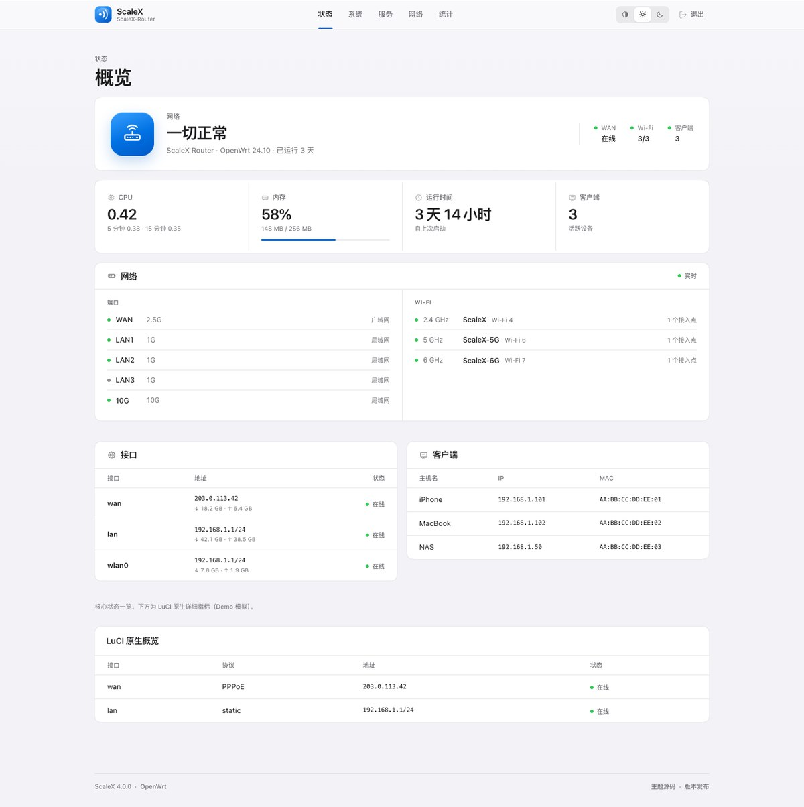

# ScaleX 4.0 — 设计规范

> 一款为 OpenWrt / LuCI 打造的 Apple 风格主题。
> 设计命题：**路由器后台也可以安静、清楚、值得信任。**



---

## 1. 设计方向

**Apple.com 的顶部导航，网络控制台的内容。**

ScaleX 4.0 把导航放回顶部：桌面是居中的横向文字菜单，L2 在悬停 / 聚焦时展开为玻璃菜单；手机保留顶部品牌栏与菜单按钮，L2 收成标题下的分段控件。侧边栏与底部 Tab Bar 都已移除。

| 原则 | 落地 |
|------|------|
| **内容优先，外壳后退** | 52px 顶部玻璃导航；内容卡片不透明 |
| **一个页面一个任务** | 首屏回答「网络现在怎么样」，细节交给下方分组 |
| **分组而不是堆卡片** | 四项 Vitals 共用一块面板；端口、无线、接口、客户端都是分组列表 |
| **状态用点，不用彩色药丸** | 绿色只用于 6px 状态点；文字保持中性色 |
| **一个强调色** | 蓝色只给主操作、焦点、选中项；绿色只表示在线 |
| **安静的细节** | 发丝分隔线、20px 连续圆角、极轻的 1px 轮廓 |

### 签名元素

蓝色圆角路由器图标 + 右侧三列实时状态；导航保持 Apple.com 的低存在感，让状态面板成为唯一有重量的区域。

---

## 2. 颜色

| Token | 浅色 | 深色 | 用途 |
|-------|------|------|------|
| `--scalex-bg` | `#F2F2F7` | `#000000` | 页面画布 |
| `--scalex-bg-elevated` | `#FFFFFF` | `#1C1C1E` | 卡片、菜单 |
| `--scalex-bg-inset` | `#F2F2F7` | `#2C2C2E` | 输入框、分段控件 |
| `--scalex-text` | `#1D1D1F` | `#F5F5F7` | 主文字 |
| `--scalex-text-secondary` | `#6E6E73` | `#A1A1A6` | 说明、标签、表头 |
| `--scalex-accent` | `#0071E3` | `#0A84FF` | 主操作、选中、焦点 |
| `--scalex-success` | `#34C759` | `#30D158` | 仅在状态点 |
| `--scalex-danger` | `#FF3B30` | `#FF453A` | 仅错误/离线点 |

对比度：主文字 15.6:1（深色）/ 16.8:1（浅色）；次要文字 5.1:1（白底）、5.2:1（深色卡片）。强调文字 `#0066CC` 在浅蓝选中底上为 4.9:1。

---

## 3. 字体

- 系统字体：`-apple-system, BlinkMacSystemFont, "SF Pro Text", "SF Pro Display", "PingFang SC", "Helvetica Neue", sans-serif`
- 数字：等宽数字 `font-variant-numeric: tabular-nums`；技术值使用 `ui-monospace / SF Mono`。
- 层级靠字号和字重，不靠颜色堆叠。

| 角色 | 字号 / 行高 | 字重 |
|------|-------------|------|
| 页面标题 | 32 / 35 | 600 |
| 状态标题 | 28 / 33 | 600 |
| 区块标题 | 15 / 20 | 600 |
| 正文 | 15 / 22 | 400 |
| 顶部导航 | 14 / 20 | 500–600 |
| 控件 / 表格 | 13 / 18 | 400–500 |
| 说明 / 表头 | 11–12 / 16 | 400–500 |
| 技术数据 | 11 / 16 | 400 mono |

字距：大标题 `-0.032em`，状态标题 `-0.03em`；中文不额外加字距。

---

## 4. 布局

### 4.1 桌面（≥ 901px）

```text
┌──────────────────────────────────────────────────────────────────────┐
│  ◉ ScaleX      状态   系统   服务   网络   统计        ◐ ☀ ☾  退出  │  52px 玻璃
│                 ────                                                 │
├──────────────────────────────────────────────────────────────────────┤
│  状态                                                                 │
│  概览                                                                 │
│  ┌────────────────────────────────────────────────────────────────┐  │
│  │ ◉  网络 / 一切正常              WAN   Wi-Fi   客户端           │  │
│  │    主机 · 固件 · 运行时间       在线   3/3     3               │  │
│  └────────────────────────────────────────────────────────────────┘  │
│  ┌──────────┬──────────┬──────────┬──────────┐                       │
│  │ CPU      │ 内存      │ 运行时间  │ 客户端    │                       │
│  └──────────┴──────────┴──────────┴──────────┘                       │
│  ┌────────────────────────────────────────────────────────────────┐  │
│  │ 网络            端口 / Wi-Fi 分组列表                           │  │
│  └────────────────────────────────────────────────────────────────┘  │
│  ┌────────────────────────────┬──────────────────────────────────┐  │
│  │ 接口                        │ 客户端                            │  │
│  └────────────────────────────┴──────────────────────────────────┘  │
└──────────────────────────────────────────────────────────────────────┘
       最大 1180px 内容区，页面左右留白 40px
```

- 顶部栏 52px，品牌左、导航居中、外观/退出右。
- L1 链接 14px；当前项文字加粗 + 2px 蓝色下划线，不使用填充药丸。
- L2 菜单：玻璃面板、12px 圆角、34px 行高；悬停、聚焦、点击外部关闭。
- 内容区最大 1180px；标题与卡片同轴。
- 没有侧边栏，也没有底部 Tab Bar。

### 4.2 移动（≤ 900px）

- 顶部栏保留 54px：品牌、外观、菜单按钮。
- 主导航进入底部 Sheet：grabber、标题、关闭按钮、可展开分组；当前分组自动展开。
- 当前分区的 L2 页面变成标题下的分段控件，可横向滚动。
- 页面左右留白 20px，640px 以下 16px；标题 26px。
- 指标 2×2；网络分组上下堆叠；表格转为 label/value 行。

### 4.3 18.06 legacy

Lua 模板使用服务端顶部导航：L1 横向链接、L2 悬停/聚焦菜单、移动端菜单 Sheet。Surface、字体、状态点、表格和 Sheet 与新壳共用 token。

---

## 5. 组件

### 5.1 顶部导航
- 背景 `rgba(250,250,252,.72)` + `blur(24px) saturate(180%)`，底部 1px 分隔线。
- 当前 L1：文字 600 + 2px 蓝色下划线；未选中为次要色。
- L2 菜单 232px 宽，玻璃背景，行高 34px；选中项蓝色文字。
- 键盘：Tab 进入 L1，聚焦展开 L2；Escape 关闭。

### 5.2 状态面板
- 78px 蓝色圆角图标（22px 圆角，160° 渐变，1px 内高光）。
- 左侧：网络 / 状态标题 / 主机 · 固件 · 运行时间。
- 右侧：WAN、Wi-Fi、客户端三列；每列 6px 状态点 + 10px 标签 + 13px 值。
- 移动端右侧三列移到面板底部，用顶部发丝线分隔。

### 5.3 Vitals
- 一块面板，四列；列间 1px 分隔。
- 标签 12px 次要色 + 14px 线性图标；数值 26px / 600；注释 11px。
- 内存条 3px 高，仅内存列有；颜色随阈值变化。
- 移动端 2×2，第二行顶部加分隔线。

### 5.4 网络分组
- 一张卡片，左右两列：端口 / Wi-Fi；列间 1px 分隔。
- 行高 36px，行间发丝线；状态点 + 名称 + 速率/频段 + 角色/接入点。
- 没有端口或无线时隐藏对应列；两者都没有时隐藏整卡。

### 5.5 表格
- 表头 11px 次要色，标题式大小写，不使用全大写字距。
- 行高 44px，行间发丝线；数字使用 mono + tabular-nums。
- 状态列使用状态点 + 文字，不使用彩色背景。
- 移动端每行转为 label/value 两列；`data-label` 提供字段名。

### 5.6 表单与开关
- 输入框高 36px，圆角 9px，填充式背景，无边框；聚焦 3px 蓝色外环。
- 原生 LuCI flag 渲染为 40×24 的 iOS 开关，绿色仅表示开启。
- 设置页使用 190px 标签列 + 内容列；分组卡片 20px 圆角；底部右对齐主操作。

### 5.7 移动 Sheet
- 底部圆角 26px，玻璃背景，最大宽 520px。
- 顶部 grabber、标题、关闭按钮。
- 分组用原生 `<details>`，当前分组自动展开；底部退出。
- 打开时 `inert` 主界面，焦点进入关闭按钮，`Esc` 关闭。

---

## 6. 动效

| 场景 | 时长 / 曲线 |
|------|-------------|
| 内容进入 | 380ms / `cubic-bezier(.22,1,.36,1)`，6px 上移 + 淡入 |
| Sheet 打开/关闭 | 420ms / 弹簧曲线 |
| 悬停、按压 | 140ms / ease-out |
| L2 菜单 | 140ms / 透明度 + 2px 位移 |

- 不使用持续呼吸、漂浮或装饰性循环动画。
- `prefers-reduced-motion: reduce` 关闭位移和过渡。
- `prefers-reduced-transparency: reduce` 用实色替代玻璃。
- `prefers-contrast: more` 加强分隔线和焦点环。

---

## 7. 可访问性

- 跳过导航链接；焦点环 2px 蓝色 + 2px offset。
- 当前页使用 `aria-current="page"`；L2 菜单可用键盘聚焦，Escape 关闭。
- 移动 Sheet：`role=dialog`、`aria-modal`、焦点陷阱、`Esc`、关闭后归还焦点。
- 触控目标：移动 ≥ 44px；桌面控件 ≥ 28px。
- 状态不只用颜色：点旁始终有文字。
- 表格移动端保留表头语义（`caption` + `data-label`）。
- 深浅色都经过对比度检查；状态色只用于 6px 点。

---

## 8. 文件结构

```text
htdocs/luci-static/scalex/
├── css/
│   ├── variables.css       # token（颜色、字号、间距、玻璃）
│   ├── base.css            # reset、字体、背景、焦点
│   ├── layout.css          # 顶部导航、页头、Sheet
│   ├── glass.css           # 仅功能层玻璃
│   ├── components.css      # LuCI 表单、按钮、表格、开关
│   ├── dashboard.css       # 状态面板、Vitals、网络分组
│   ├── login.css           # 登录页
│   ├── adaptive.css        # 第三方 LuCI app 适配
│   ├── openwrt.css         # OpenWrt 预设
│   ├── symbols.css         # 线性符号
│   └── legacy.css          # 18.06 顶部导航兼容
├── js/legacy.js            # 18.06 交互
├── img/                    # 标记、favicon、符号集
└── icons/menu/             # 菜单图标
```

```text
htdocs/luci-static/resources/
├── menu-bootstrap-core.js  # LuCI 菜单树归一化
├── menu-scalex.js          # 顶部导航 / L2 菜单 / 移动 Sheet
├── theme-scalex.js         # Auto / Light / Dark
├── dashboard-scalex.js     # RPC、状态面板、Vitals、分组
└── ui-scalex.js            # 第三方页面适配
```

---

## 9. 约束

- 主路径：OpenWrt 23.05 / 24.10 / ImmortalWrt，ucode 模板。
- LuCI 24.10 菜单根节点是 `admin`；所有路径和 active 判断都要归一化。
- 不依赖外部字体、图片 CDN 或运行时 CSS-in-JS。
- 玻璃只在功能层；正文卡片不使用 `backdrop-filter`。
- 18.06 只做基础兼容，不在 CI 中跑真实固件。
