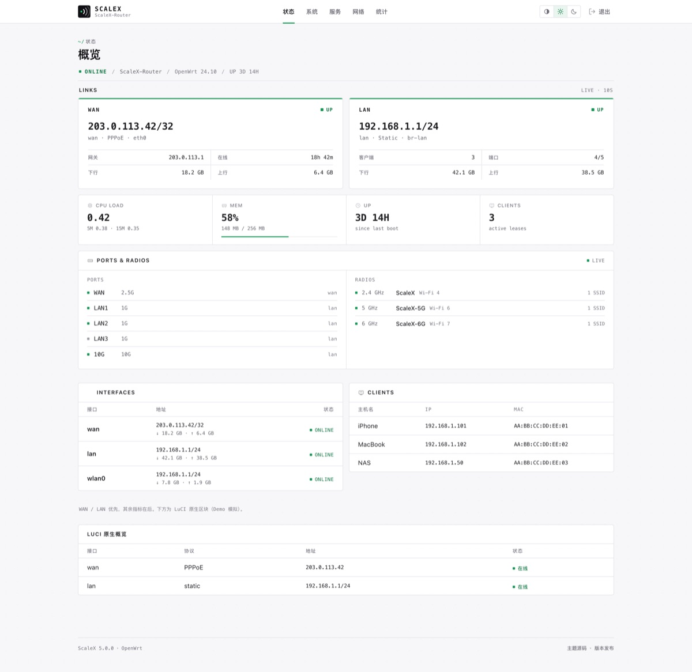
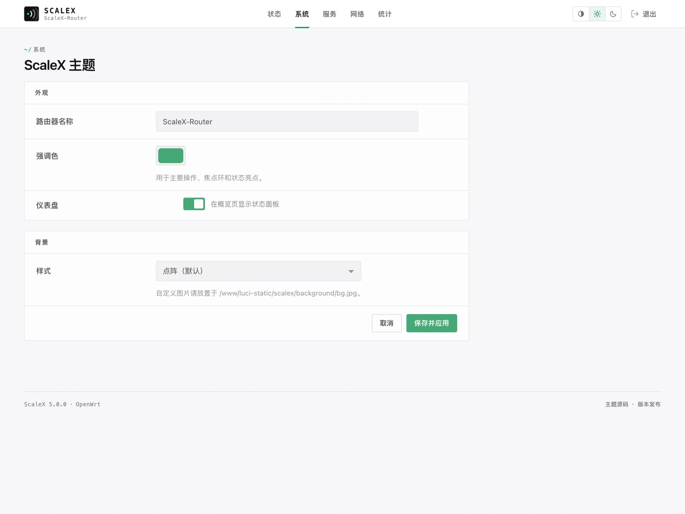

# luci-theme-scalex

[](https://github.com/Jas0n0ss/openwrt-theme-scalex/actions/workflows/build.yml)

**ScaleX 5.0** — 一款简约极客风的 OpenWrt / LuCI 主题。
纸面与墨色、单一信号绿、发丝分隔线、方角与等宽数字；首页第一屏直接给出 **WAN 与 LAN 的实时连接状态**。

**当前版本：** `5.0.0`



---

## 为什么是 ScaleX 5.0

| 设计目标 | 实现 |
|----------|------|
| **首页先看链路** | WAN / LAN 双卡并排首屏：连接状态、地址、ISP 网关、在线时长、实时上下行，LAN 另有客户端数与端口占用 |
| **简约极客** | 单一信号绿、2–8px 方角、等宽数据字体、点阵画布、发丝分隔线；没有玻璃、渐变、彩色光斑与投影 |
| **信息密度** | 顶部一行系统状态（ONLINE / 主机名 / 固件 / 运行时间），四格指标（CPU / MEM / UP / CLIENTS），端口与射频一览 |
| **真正可用的移动端** | ≤900px 保留顶部品牌栏与菜单按钮；L2 变成标题下的分段控件，完整导航进入 Sheet，焦点陷阱、Escape、触控目标 ≥44px |
| **完整深色模式** | Auto / Light / Dark 三态；深色是独立的纸面与墨色，不是简单反色 |
| **不牺牲 LuCI 功能** | 保留 Bootstrap CBI / 表格 / 表单底座，第三方插件通过 `ui-scalex.js` 自动适配 |
| **可访问** | 跳过导航、可见焦点、键盘可操作菜单、`prefers-reduced-motion`、`prefers-reduced-transparency`、表格移动端重排 |

**深色模式**


**登录页**


**移动端**


---

## 兼容性

| 固件 | 模板 | 状态 |
|------|------|------|
| OpenWrt 23.05+ / 24.x | `ucode/*.ut` | ✅ 推荐 |
| ImmortalWrt | `ucode/*.ut` | ✅ |
| OpenWrt 22.03 | `ucode/*.ut` | ⚠️ 基本可用，未在 CI 覆盖 |
| LEDE 18.06 / Lean | Lua `luasrc/` | ⚠️ 基础兼容层（服务端顶部导航 + 菜单 Sheet），未实机覆盖 |

依赖：`luci-theme-bootstrap`（提供 CBI / 表单 / 表格底座，固件一般已自带）。

### 已验证环境

| 环境 | 结果 |
|------|------|
| OpenWrt 24.10 x86_64 rootfs + `uhttpd` + `ucode`（Docker/QEMU） | ✅ IPK 安装、登录页、静态资源、ucode 模板 |
| Chromium（Playwright / Chrome） | ✅ 8 个宽度、顶部导航 + L2 菜单、主题切换、移动 Sheet |
| WebKit 27.2（Safari 引擎） | ⚠️ 4.0 通过，5.0 未重跑 |
| Firefox 157（Linux Playwright 容器） | ⚠️ 4.0 通过，5.0 未重跑 |
| LEDE 18.06 静态壳层 | ✅ 顶部导航、L2 菜单、主题切换、Sheet（fixture） |
| 物理路由器 | ⚠️ 未覆盖 |

> 容器测试使用真实 OpenWrt 24.10 userland，但不是物理路由器；`tests/real-router.sh` 可复现。

---

## 安装

### 方式 A：预编译 `.ipk`（推荐）

从 [Releases](https://github.com/Jas0n0ss/openwrt-theme-scalex/releases) 下载：

```sh
opkg install luci-theme-scalex_5.0.0-1_all.ipk
opkg install luci-app-scalex-config_5.0.0-1_all.ipk

uci set luci.main.mediaurlbase='/luci-static/scalex'
uci commit luci
/etc/init.d/uhttpd restart
```

然后在 **System → System → Language and Style → Design** 选择 **ScaleX**。

### 方式 B：编译进固件

```sh
cd openwrt/package
git clone https://github.com/Jas0n0ss/openwrt-theme-scalex.git luci-theme-scalex
cp -r luci-theme-scalex/luci-app-scalex-config .

make menuconfig
# LuCI → Themes → luci-theme-scalex
# LuCI → Applications → luci-app-scalex-config

make package/luci-theme-scalex/compile V=s
make package/luci-app-scalex-config/compile V=s
```

### 中文界面

IPK 内置 `zh_Hans` 翻译，无需额外安装语言包：

```sh
uci set luci.main.lang='zh_Hans'
uci commit luci
/etc/init.d/uhttpd restart
```

---

### 升级后仍然看到旧布局？

5.0 沿用顶部导航结构，但视觉换成了极客风：桌面是居中横向文本菜单 + 实心 L2 下拉；手机是顶部品牌栏 + 菜单按钮 + Sheet。首页首屏为 WAN / LAN 双卡。

```sh
opkg list-installed | grep scalex
# 应显示 luci-theme-scalex 5.0.0-1 / luci-app-scalex-config 5.0.0-1

uci get luci.main.mediaurlbase
# 应为 /luci-static/scalex
```

- 如果看到侧边栏或底部 Tab Bar，说明仍是 3.1 / 3.0 包；升级到 5.0.0。
- 浏览器缓存：`Cmd/Ctrl + Shift + R`，或开发者工具禁用缓存后刷新。
- LEDE 18.06：预编译 IPK 面向 23.05+；18.06 需要从源码编译，5.0 的 Lua 模板同样沿用顶部导航壳层。
- 页面底部会显示 `ScaleX 5.0.0`；确认版本号后再判断布局。

## 主题配置

**System → ScaleX Theme**，或使用 UCI。强调色留空即使用默认信号绿，无需手动写入：




```sh
uci set scalex.global.primary='#0A8F4D'
uci set scalex.global.dark_primary='#2ED97C'
uci set scalex.global.font_size='16'
uci set scalex.global.background_mode='dots'       # dots（点阵，默认）| none（纯色）| custom（自定义图片）
uci set scalex.global.dashboard='1'
uci commit scalex
```

自定义背景：把图片放到 `/www/luci-static/scalex/background/bg.jpg`（也支持 `.png` / `.webp`），然后选择 `custom`。主题会自动叠加可读性遮罩。

---

## 本地预览

```sh
./demo/serve.sh
# http://127.0.0.1:9080/demo/
```

- `概览` / `主题设置` / `登录` 三个视图
- 右下角浮层可切换视图
- `?clean=1` 隐藏浮层，`?theme=light|dark` 固定外观，`?view=login|settings` 直达视图，用于截图
- 支持 `localStorage` 主题偏好

---

## 构建与测试

```sh
# 1. 构建 IPK（自动编译 zh_Hans .lmo）
./scripts/build-ipk.sh

# 2. 校验包内容、资源、i18n、2.0 组件
./scripts/verify-ipk.sh

# 3. JS 语法检查
find htdocs/luci-static/resources htdocs/luci-static/scalex/js demo -name '*.js' -exec node --check {} \;

# 4. 可选：浏览器 UI 冒烟测试
python3 -m venv .venv
.venv/bin/pip install -r tests/requirements.txt
.venv/bin/python tests/ui-smoke.py --base-url http://127.0.0.1:9080/demo/ --channel chrome
.venv/bin/python tests/ui-smoke.py --base-url http://127.0.0.1:9080/demo/ --engine webkit
.venv/bin/python tests/legacy-smoke.py --base-url http://127.0.0.1:9080/tests/fixtures/legacy.html

# 5. 可选：真实 OpenWrt 24.10 userland（需要 Docker + QEMU）
./tests/real-router.sh start
# http://127.0.0.1:18080/cgi-bin/luci/  root / root
./tests/real-router.sh stop
```

测试覆盖：

- 320 / 360 / 390 / 768 / 980 / 1024 / 1280 / 1440px：无横向溢出
- 桌面顶部导航 + L2 下拉、主题三态、移动菜单 Sheet 开关/焦点
- 登录按钮强调色、表单可访问性
- 截图输出到 `tests/artifacts/`

---

## 项目结构

```
openwrt-theme-scalex/
├── .github/workflows/build.yml       # CI：构建 + 校验 + Release
├── htdocs/luci-static/scalex/
│   ├── css/                          # 设计 token、壳层、组件、仪表盘
│   ├── icons/menu/                   # LuCI 菜单图标
│   ├── img/                          # ScaleX 标记、favicon、符号集
│   └── ...
├── htdocs/luci-static/resources/
│   ├── menu-scalex.js                  # 顶部导航 / L2 菜单 / 移动 Sheet
│   ├── theme-scalex.js                 # Auto / Light / Dark
│   ├── dashboard-scalex.js             # 状态 / Vitals / 网络面板
│   ├── ui-scalex.js                    # 第三方 app 适配
│   └── menu-bootstrap-core.js
├── luasrc/view/themes/scalex/          # Lua / LuCI 18.06 基础兼容层
├── htdocs/luci-static/scalex/js/legacy.js
├── ucode/template/themes/scalex/       # header / footer / sysauth
├── luci-app-scalex-config/             # 主题配置应用
├── demo/                             # 无路由器预览
├── docs/                             # 预览图
├── scripts/                          # 构建、校验、发布
├── tests/                            # Playwright 冒烟测试 + 真实 router 沙箱
└── DESIGN.md                         # 设计规范
```

---

## CI 与 Release

推送到 `main` / `master`、打 `v*` 标签或手动触发时：

1. `node --check` 检查全部前端 JS
2. 构建两个 `.ipk`
3. `verify-ipk.sh` 校验包格式、权限、资源、i18n、2.0 组件
4. 上传 Actions Artifacts
5. 自动创建 GitHub Release，附带两个 `.ipk`

手动触发：**Actions → Build IPK → Run workflow**

---

## 文档

- [DESIGN.md](DESIGN.md) — 设计规范、token、组件、无障碍
- [CODE_REVIEW.md](CODE_REVIEW.md) — 2.0 审查、修复项、测试记录、已知边界
- [CHANGELOG.md](CHANGELOG.md) — 版本变更

---

## License

[Apache License 2.0](LICENSE)

OpenWrt 是 OpenWrt 项目的注册商标。ScaleX 是独立主题项目，与 Apple Inc. 无关联。
